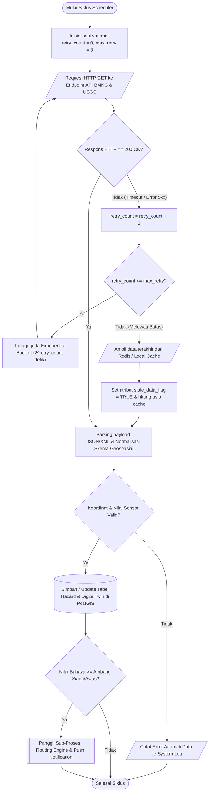
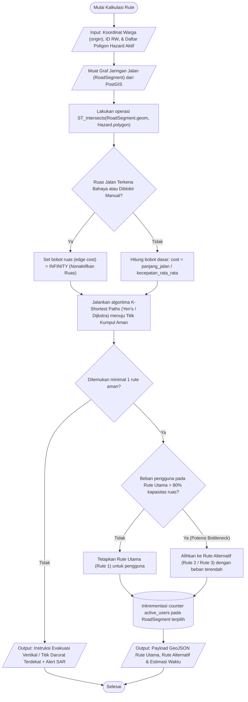
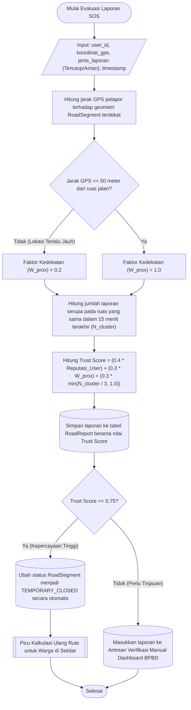

# 🔄 Flowchart Sistem & Algoritma Inti
**HyperEvac System** · Rekayasa Perangkat Lunak · Universitas Samudra

> [!NOTE]
> Dokumen ini memisahkan **Flowchart Algoritma & Pemrosesan Sistem** dari **Activity Diagram**. Flowchart di bawah ini berfokus pada logika prosedural, percabangan komputasi, struktur perulangan (*loop*), serta pengolahan input/output di sisi mesin (*engine*), sedangkan interaksi lintas-aktor (*swimlane*) didokumentasikan secara terpisah pada berkas `ACTIVITY-DIAGRAM.md`.

---

## 1. Flowchart Algoritma Akuisisi, Validasi & Fallback Cache API (`DataAggregator`)

Menggambarkan alur logika internal *background worker* saat menarik data cuaca/gempa dari BMKG & USGS, termasuk mekanisme *exponential backoff retry* dan *fallback* ke *cache* lokal apabila API eksternal mengalami gangguan.

---

## 2. Flowchart Algoritma Perhitungan Rute Dinamis & Anti-Bottleneck (`Routing Engine`)

Menggambarkan logika komputasi spasial di PostGIS dalam memotong ruas jalan yang terendam/diblokir dan mendistribusikan warga ke beberapa rute alternatif agar tidak terjadi penumpukan (*traffic bottleneck*).

---

## 3. Flowchart Algoritma Evaluasi *Trust Score* Laporan Warga (`Crowd-Sensing SOS`)

Menggambarkan logika perhitungan skor kepercayaan laporan kondisi jalan dari warga untuk menentukan apakah ruas jalan langsung ditandai otomatis atau masuk ke antrean verifikasi manual BPBD.

