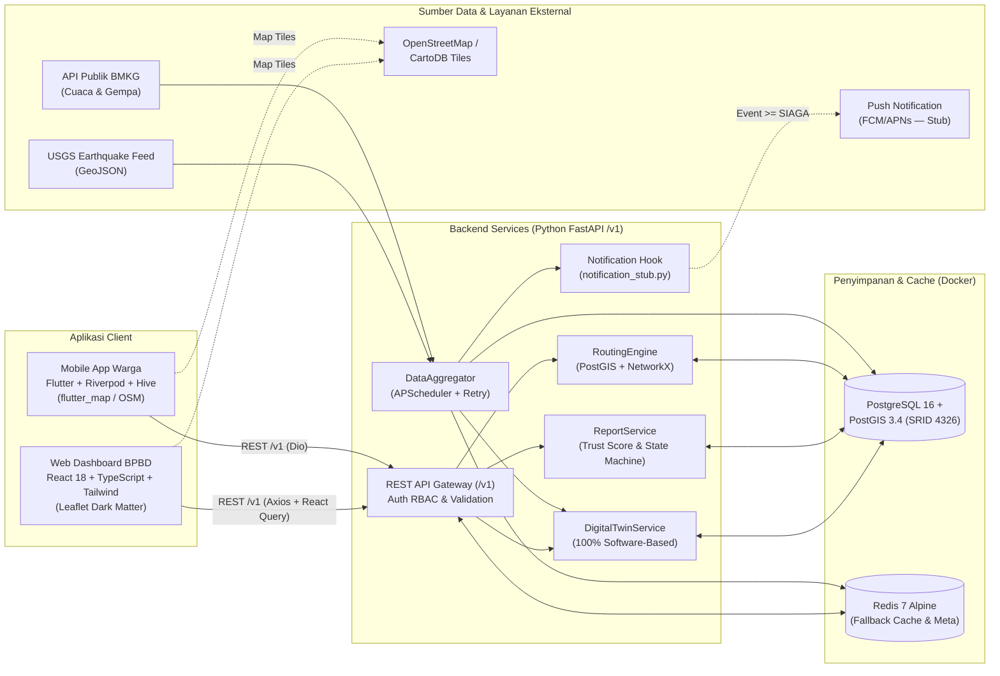
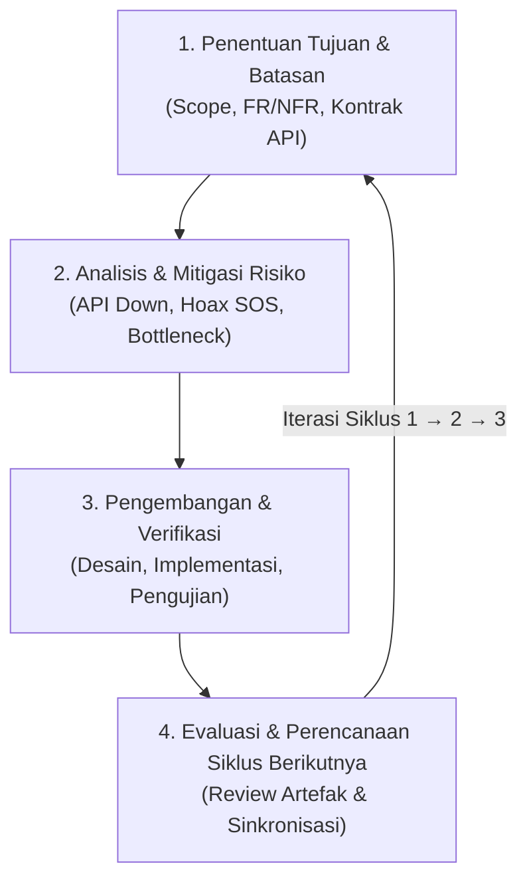

<div align="center">



<br/>

-00f0ff?style=for-the-badge&labelColor=0b1020)


### `> Pengembangan Sistem Informasi Peringatan Dini dan Navigasi Evakuasi Bencana Hyper-Lokal`
**Berbasis Real-Time Data Aggregation · Menggunakan Model Spiral**

</div>


## 📡 Daftar Isi

1. [Ringkasan Proyek](#-ringkasan-proyek)
2. [Latar Belakang & Permasalahan](#-latar-belakang--permasalahan)
3. [Tujuan & Ruang Lingkup](#-tujuan--ruang-lingkup)
4. [Klasifikasi & Karakteristik Perangkat Lunak](#-klasifikasi--karakteristik-perangkat-lunak)
5. [Stakeholder Ekosistem](#-stakeholder-ekosistem)
6. [Kebutuhan Sistem](#-kebutuhan-sistem)
7. [Arsitektur Sistem](#-arsitektur-sistem)
8. [Model Data & Kontrak API](#-model-data--kontrak-api)
9. [Pemodelan Proses SDLC: Model Spiral](#-pemodelan-proses-sdlc-model-spiral)
10. [Siklus Iterasi Pengembangan](#-siklus-iterasi-pengembangan)
11. [Inovasi: Predictive Digital Twin Engine](#-inovasi-predictive-digital-twin-engine)
12. [Analisis Risiko](#-analisis-risiko)
13. [Kelebihan, Kelemahan & Strategi Mitigasi](#-kelebihan-kelemahan--strategi-mitigasi)
14. [Strategi Pengujian](#-strategi-pengujian)
15. [Rencana Anggaran & Kelayakan](#-rencana-anggaran--kelayakan)
16. [Roadmap](#-roadmap)
17. [Struktur Repository](#-struktur-repository)
18. [Tim Pengembang](#-tim-pengembang)
19. [Kesimpulan](#-kesimpulan)
20. [Daftar Pustaka](#-daftar-pustaka)


## 🛰️ Ringkasan Proyek

**HyperEvac System** adalah sistem informasi berbasis perangkat lunak murni (*100% software-based*, tanpa sensor fisik/IoT) yang memberikan **peringatan dini otomatis** dan **navigasi rute evakuasi teraman** hingga ke tingkat **ruas jalan/RW** saat bencana terjadi. Sistem menarik data cuaca ekstrem dan gempa bumi dari API publik gratis (BMKG dan USGS) secara periodik, membangun representasi kondisi wilayah melalui **Digital Twin Engine** berbasis estimasi perangkat lunak, serta menghitung ulang rute evakuasi secara dinamis di peta mobile warga.

> [!NOTE]
> Dokumen ini merupakan **proposal akademik** untuk mata kuliah Rekayasa Perangkat Lunak, Program Studi Informatika, Universitas Samudra. Seluruh rancangan inti pada proposal ini telah direalisasikan dalam bentuk prototipe *full-stack* pada **Sprint 1–3** dan tervalidasi secara lokal melalui `pytest`, `npm run build`, `flutter analyze`, serta `flutter test` (lihat [`README.md`](../README.md) dan [`PROJECT_OVERVIEW.md`](../PROJECT_OVERVIEW.md)). Layanan *push notification* FCM/APNs saat ini masih berupa *stub* (`notification_stub.py`), dan pengujian beban produksi serta deployment publik belum diklaim siap produksi.

| Atribut | Keterangan |
|---|---|
| **Nama Sistem** | HyperEvac System |
| **Kategori** | Real-Time Data Aggregator & Cloud GIS System |
| **Platform** | Mobile App Warga (Flutter), Web Dashboard BPBD (React 18 + TypeScript), API Backend (Python FastAPI `/v1`) |
| **Karakter** | Critical-Safety (*high availability*, *fallback cache*, *safety-critical state machine*) |
| **Metode SDLC** | Model Spiral (*risk-driven approach*, 3 Siklus) |
| **Pendekatan** | 100% Software-Based (tanpa sensor fisik/IoT; `tinggi_genangan_cm` adalah estimasi perangkat lunak dari data curah hujan BMKG, laporan warga terverifikasi, atau input manual Operator BPBD) |


## 🚨 Latar Belakang & Permasalahan

Pendekatan peringatan bencana konvensional kerap gagal menjangkau kebutuhan navigasi mikro di lapangan saat krisis berlangsung.

| ❌ Permasalahan Eksisting | ✅ Solusi HyperEvac |
|---|---|
| **Informasi terlambat & berskala makro.** Peringatan dini umumnya berskala kabupaten/kota sehingga warga tidak mengetahui ruas jalan spesifik di RW-nya yang aman dilalui. | **Hyper-Local Software-Only Aggregation.** Menarik data publik BMKG & USGS secara periodik dengan *retry exponential backoff* dan *Redis fallback cache* tanpa ketergantungan perangkat keras lapangan. |
| **Rute evakuasi statis & rawan macet.** Peta jalur evakuasi cetak tidak beradaptasi ketika jalan terendam atau longsor, serta rawan menyebabkan *bottleneck* di satu koridor. | **Dynamic Routing Engine (PostGIS + NetworkX).** Menghindari zona bahaya via `ST_Intersects`, mendistribusikan beban rute anti-*bottleneck* (`> 80%` kapasitas), dan menyediakan *fallback* **Evakuasi Vertikal + Alert SAR**. |
| **Biaya & kerentanan sensor fisik/IoT.** Sensor banjir fisik mahal, rentan rusak tersapu arus, dicuri, dan membutuhkan perawatan perangkat keras rutin. | **Crowdsourcing SOS + Trust Score & Kendali BPBD.** Warga melaporkan kondisi ruas (`tertutup`/`aman`) secara online maupun *Offline Queue* (Hive), dievaluasi *Trust Score*, dan diverifikasi oleh Operator BPBD. |


## 🎯 Tujuan & Ruang Lingkup

### Tujuan

1. Menyediakan **agregasi data bahaya otomatis** dari API publik BMKG dan USGS yang tahan gangguan jaringan melalui *retry* dan *Redis fallback cache* (`data_kedaluwarsa`).
2. Memandu warga melalui **navigasi rute evakuasi dinamis** di peta OpenStreetMap (`flutter_map`) yang otomatis menghindari zona bahaya dan memecah kemacetan (*anti-bottleneck*).
3. Menyediakan **Web Dashboard Command Center** berbasis React + Leaflet bagi Operator BPBD/Tim SAR untuk memantau **Digital Twin** (100% *software-based*), memverifikasi laporan SOS warga, serta memblokir/membuka ruas jalan secara manual.
4. Menjamin **observabilitas dan keandalan** layanan inti melalui *endpoint* `/v1/health`, pengujian otomatis offline, dan skrip *load testing* dasar.

### Ruang Lingkup

| ✅ Termasuk (In Scope) | 🚫 Tidak Termasuk (Out of Scope) |
|---|---|
| Agregasi periodik API publik BMKG & USGS (APScheduler) + Redis fallback cache | Pengadaan, instalasi, atau pembacaan sensor fisik / perangkat IoT |
| Basis data spasial PostgreSQL + PostGIS (SRID 4326 / WGS 84) untuk 7 entitas domain | Sistem sirene fisik atau perangkat keras peringatan lapangan |
| Routing evakuasi dinamis (`ST_Intersects`, NetworkX, anti-*bottleneck* >80%, *Evakuasi Vertikal*) | Peta 3D fotorealistis berskala kota/provinsi |
| Pelaporan kondisi jalan warga via tombol SOS (`POST /v1/reports`) + *Offline Queue* (Hive) | Integrasi langsung ke sistem internal instansi di luar API publik terbuka |
| Web Dashboard BPBD (React 18, TypeScript, Tailwind CSS, Leaflet CartoDB Dark Matter) | Manajemen logistik, pengungsian, dan rehabilitasi pascabencana |
| *Stub* pemicu Push Notification (FCM/APNs) & skrip *load testing* dasar (Locust) | Pengiriman FCM/APNs produksi dengan kredensial berbayar & distribusi toko aplikasi |

> [!NOTE]
> **Batasan Non-IoT:** Seluruh metrik *Digital Twin*—termasuk `tinggi_genangan_cm`—merupakan hasil estimasi perangkat lunak berdasarkan data curah hujan BMKG, laporan warga terverifikasi, atau input manual Operator BPBD, bukan hasil pembacaan sensor fisik.


## 🧬 Klasifikasi & Karakteristik Perangkat Lunak

| Aspek | Deskripsi |
|---|---|
| **Tujuan Software** | Peringatan dini otomatis dan pemanduan rute evakuasi teraman hingga tingkat ruas jalan/RW saat krisis bencana. |
| **Jenis Software** | **Real-Time Data Aggregator & Cloud GIS System** — ekosistem multi-aplikasi murni perangkat lunak (Mobile App Flutter, Web Dashboard React, REST API Python FastAPI). |
| **Karakteristik Utama** | **Critical-Safety.** Membutuhkan ketahanan terhadap kegagalan sumber eksternal (*fallback cache*), aturan keamanan ketat pada perubahan status jalan, serta perlindungan dari *overload* saat lonjakan trafik. |

> [!TIP]
> **Implikasi Rekayasa Perangkat Lunak:** Karakter *critical-safety* menuntut pemilihan SDLC berbasis **analisis risiko** di setiap iterasi, sehingga **Model Spiral** menjadi pendekatan yang paling tepat.


## 👥 Stakeholder Ekosistem

Peta interaksi aktor manusia dan sistem eksternal terhadap **HyperEvac System** (selaras dengan [`sprint-2/CONTEXT-DIAGRAM.md`](../sprint-2/CONTEXT-DIAGRAM.md) dan [`sprint-1/USER-STORY.md`](../sprint-1/USER-STORY.md)):

| Kode | Stakeholder / Entitas | Kategori | Platform / Antarmuka | Interaksi Utama |
|---|---|---|---|---|
| `ACT-01` | **Warga Area Rawan** | Aktor Manusia | 📱 Mobile App (Flutter Android/iOS) | Mendaftarkan perangkat, melihat peta zona bahaya & titik kumpul, mengikuti navigasi rute evakuasi dinamis, dan mengirim laporan SOS (`tertutup`/`aman`) online maupun *offline*. |
| `ACT-02` | **Operator BPBD / Tim SAR** | Aktor Manusia | 🖥️ Web Dashboard (React 18 + Leaflet) | Memantau *Live Digital Twin* per RW, memverifikasi antrean laporan SOS warga (`diterima`/`ditolak`), serta memblokir/membuka ruas jalan secara manual. |
| `ACT-03` | **Tim Maintainer / DevOps** | Aktor Manusia | ☁️ Cloud Console & `/v1/health` | Memantau kesehatan PostGIS, Redis, status konektor BMKG/USGS, usia cache, latensi database, dan performa sistem. |
| `EXT-01` | **Sistem Eksternal BMKG** | Sistem Eksternal | API Publik BMKG | Sumber data cuaca ekstrem dan gempa bumi gratis (wajib atribusi `Sumber: BMKG`). |
| `EXT-02` | **Sistem Eksternal USGS** | Sistem Eksternal | GeoJSON Earthquake Feed | Sumber data sekunder kejadian gempa bumi global dalam format GeoJSON. |
| `EXT-03` | **OpenStreetMap & CartoDB Tiles** | Sistem Eksternal | Tile Server Peta | Penyedia layer peta dasar untuk `flutter_map` (Mobile) dan Leaflet CartoDB Dark Matter (Web Dashboard). |
| `EXT-04` | **Push Notification Service (FCM/APNs)** | Sistem Eksternal | Layanan Notifikasi Darurat | Kanal pengiriman notifikasi darurat saat `level_bahaya >= SIAGA` (saat ini berupa *stub* di backend). |


## 📋 Kebutuhan Sistem

> [!NOTE]
> Pemetaan lengkap `FR ↔ UC ↔ US ↔ Endpoint` terdokumentasi di [`sprint-2/USE-CASE.md`](../sprint-2/USE-CASE.md), [`sprint-1/USER-STORY.md`](../sprint-1/USER-STORY.md), dan [`sprint-1/ACTIVITY-DIAGRAM.md`](../sprint-1/ACTIVITY-DIAGRAM.md).

### Kebutuhan Fungsional (`FR-01` s.d. `FR-10`)

| ID | Use Case | User Story | Kebutuhan Fungsional | Komponen / Endpoint | Prioritas |
|---|---|---|---|---|---|
| `FR-01` | `UC8` | `US-01` | Penarikan periodik data cuaca & gempa dari API BMKG/USGS dengan *retry exponential backoff* (3×) dan *Redis fallback cache*. | Worker `DataAggregator` (APScheduler) | Tinggi |
| `FR-02` | `UC8` | `US-02` | Validasi skema/koordinat WGS 84 dan normalisasi payload sebelum disimpan ke PostGIS. | Worker `DataAggregator` | Tinggi |
| `FR-03` | `UC2` | `US-03` | Registrasi perangkat warga dan pemicu notifikasi darurat ketika `level_bahaya >= SIAGA`. | `POST /v1/devices/register` + `notification_stub.py` | Tinggi |
| `FR-04` | `UC1` | `US-04` | Menampilkan daftar bahaya aktif, poligon zona bahaya, titik kumpul, dan status `data_kedaluwarsa` per RW. | `GET /v1/hazards?rw={id}` | Tinggi |
| `FR-05` | `UC3` | `US-05` | Perhitungan rute evakuasi tercepat yang otomatis menghindari zona bahaya (`ST_Intersects`) dan ruas tertutup, termasuk *fallback* Evakuasi Vertikal + Alert SAR. | `GET /v1/routes/evacuation?lat={lat}&lng={lng}` | Tinggi |
| `FR-06` | `UC4` | `US-07` | Pelaporan kondisi jalan (`tertutup`/`aman`) oleh warga via tombol SOS (online & *Offline Queue* Hive) dengan kalkulasi *Trust Score*. | `POST /v1/reports` | Sedang |
| `FR-07` | `UC5` | `US-08` | Antrean & verifikasi laporan warga (`diterima`/`ditolak`) serta blokir/buka ruas manual oleh Operator BPBD. | `GET /v1/admin/reports`, `PATCH /v1/admin/reports/{id}`, `POST /v1/admin/routes/block`, `DELETE /v1/admin/routes/block/{segment_id}` | Tinggi |
| `FR-08` | `UC6` | `US-09` | Visualisasi *Live Digital Twin* wilayah RW (estimasi tinggi genangan, ruas tertutup, warga terdampak) berbasis perangkat lunak. | `GET /v1/twin/{rw_id}` | Sedang |
| `FR-09` | `UC3` | `US-06` | Distribusi rute evakuasi anti-*bottleneck* ke rute alternatif saat `pengguna_aktif > 0.8 * kapasitas_maks`. | `GET /v1/routes/evacuation?lat={lat}&lng={lng}` | Sedang |
| `FR-10` | `UC7` | `US-10` | Pemantauan kesehatan PostGIS, Redis, konektor BMKG/USGS, usia cache, dan latensi database. | `GET /v1/health` | Sedang |

### Kebutuhan Non-Fungsional (Target Rancangan)

| ID | Kategori | Target Rancangan |
|---|---|---|
| `NFR-01` | **Availability** | Layanan inti peringatan dini dan routing dirancang menuju target ≥ 99,5% pada deployment produksi. |
| `NFR-02` | **Latensi** | Respons API routing di bawah 500 ms pada beban normal lokal. |
| `NFR-03` | **Ketahanan Sumber Data** | *Fallback* otomatis ke Redis Cache disertai penanda eksplisit `data_kedaluwarsa: true` bila API BMKG/USGS gagal diakses. |
| `NFR-04` | **Keamanan & Akses** | Autentikasi token perangkat untuk warga, RBAC token peran `operator`/`admin` untuk endpoint `/v1/admin/*` dan `/v1/twin/*`, serta HTTPS di lingkungan produksi. |
| `NFR-05` | **Safety-Critical Data** | Laporan warga divalidasi dengan rumus *Trust Score*; laporan `aman` tidak pernah membuka ruas tanpa verifikasi BPBD. |
| `NFR-06` | **Offline Resilience** | Aplikasi mobile menyimpan laporan SOS ke penyimpanan lokal (Hive) saat kehilangan sinyal dan melakukan *auto-sync* saat terhubung kembali. |
| `NFR-07` | **Kepatuhan Atribusi** | Seluruh tampilan data BMKG pada Mobile App dan Web Dashboard menyertakan atribusi `Sumber: BMKG`. |


## 🏗️ Arsitektur Sistem

Arsitektur perangkat lunak *full-stack* yang diimplementasikan pada Sprint 3 (selaras dengan [`sprint-1/DEPLOYMENT.md`](../sprint-1/DEPLOYMENT.md)):



### Ringkasan Tech Stack Final

| Lapisan | Teknologi Final | Peran |
|---|---|---|
| **Backend API & Worker** | Python 3.11, FastAPI (`/v1`), Pydantic v2, SQLAlchemy + GeoAlchemy2, APScheduler, NetworkX, `httpx` | Layanan REST API, validasi skema, penjadwalan agregasi BMKG/USGS, dan kalkulasi graf rute. |
| **Database & Cache** | PostgreSQL 16 + PostGIS 3.4 (`SRID 4326`), Redis 7 Alpine, Docker Compose | Penyimpanan 7 entitas spasial (index `GIST`) serta *fallback cache* & metadata usia data. |
| **Web Dashboard BPBD** | React 18, Vite, TypeScript, Tailwind CSS, TanStack Query, Axios, Leaflet (CartoDB Dark Matter) | Command Center: filter RW, *Live Digital Twin*, antrean verifikasi laporan, dan blokir/buka ruas manual. |
| **Mobile App Warga** | Flutter (Dart), Riverpod, Dio, Hive (*Offline Queue*), `connectivity_plus`, `geolocator`, `flutter_map` (OpenStreetMap) | Peta bahaya, banner `data_kedaluwarsa`, navigasi rute + layar *Evakuasi Vertikal*, tombol SOS offline-first. |


## 🗄️ Model Data & Kontrak API

### 8.1. Tujuh Entitas Spasial PostGIS (`SRID 4326`)

Skema lengkap didefinisikan pada [`sprint-2/CLASS-DAN-DATABASE.md`](../sprint-2/CLASS-DAN-DATABASE.md) dan direalisasikan pada DDL [`sprint-3/Setup-Code/schema.sql`](../sprint-3/Setup-Code/schema.sql):

| No | Entitas (`<<Entity>>`) | Atribut Kunci & Geometri |
|---|---|---|
| 1 | **`RW`** | `id`, `nama_rw`, `batas_wilayah (Polygon)`, `titik_kumpul (Point)`, `data_diperbarui`, `data_kedaluwarsa` |
| 2 | **`Hazard`** | `id`, `rw_id`, `sumber`, `jenis`, `level_bahaya`, `tingkat_bahaya`, `geometri (Polygon)`, `waktu_data`, `terverifikasi` |
| 3 | **`DigitalTwin`** | `id`, `rw_id`, `zona_bahaya (Polygon)`, `tinggi_genangan_cm`, `ruas_tertutup`, `estimasi_warga_terdampak`, `perangkat_aktif`, `diperbarui_pada` |
| 4 | **`RoadSegment`** | `segment_id`, `rw_id`, `geometri (LineString)`, `panjang_m`, `kecepatan_rata_rata_mps`, `kapasitas_maks`, `pengguna_aktif`, `status`, `diblokir_manual`, `alasan` |
| 5 | **`EvacuationRoute`** | `id`, `rw_id`, `utama`, `jarak_m`, `estimasi_menit`, `beban_persen`, `status`, `geometri (LineString)`, `dihitung_pada` *(+ tabel asosiasi `evacuation_route_segment`)* |
| 6 | **`RoadReport`** | `id`, `segment_id`, `device_id`, `tipe`, `lat`, `lng`, `catatan`, `skor_kepercayaan`, `status`, `dibuat_pada`, `diverifikasi_oleh` |
| 7 | **`PerangkatWarga`** | `device_id`, `rw_id`, `fcm_token`, `reputasi`, `terakhir_aktif` |

### 8.2. Enum Status Standar & Aturan Safety-Critical

* **Flag Cache Kedaluwarsa:** `data_kedaluwarsa` (`true` / `false`).
* **Level Bahaya (`Hazard.level_bahaya`):** `AMAN`, `WASPADA` (Kuning), `SIAGA` (Oranye), `AWAS` (Merah). Ambang pemicu darurat: `>= SIAGA`.
* **Status Ruas Jalan (`RoadSegment.status`):** `AMAN`, `MENUNGGU_TINJAUAN`, `TERTUTUP_SEMENTARA`, `TERTUTUP`, `TERTUTUP_MANUAL`.
* **Laporan Warga (`RoadReport`):** `tipe` (`tertutup`, `aman`); `status` (`menunggu_tinjauan`, `terverifikasi_otomatis`, `diterima`, `ditolak`).
* **Aturan *Safety-Critical* Laporan SOS (`FLOWCHART.md` #3 & `STATE-DIAGRAM.md`):**
  * Skor kepercayaan dihitung dari reputasi perangkat, kedekatan jarak (`<= 50 m`), dan klaster laporan serupa dalam 15 menit terakhir.
  * Hanya laporan `tipe = "tertutup"` dengan `skor_kepercayaan >= 0.75` yang dapat menutup ruas secara otomatis ke status `TERTUTUP_SEMENTARA` dan memicu hitung ulang rute.
  * Laporan `tipe = "aman"` **tidak pernah** membuka ruas jalan secara otomatis meskipun `skor_kepercayaan >= 0.75`; pembukaan kembali ruas wajib melalui verifikasi Operator BPBD.

### 8.3. Ringkasan 10 Endpoint Kontrak API (`/v1`)

Spesifikasi lengkap beserta contoh payload JSON tersedia di [`sprint-1/API-SPEC.md`](../sprint-1/API-SPEC.md):

| No | Method & Endpoint | Peran | Fungsi Utama |
|---|---|---|---|
| 1 | `GET /v1/hazards?rw={id}` | Warga, Operator | Daftar bahaya aktif, poligon RW, titik kumpul, dan flag `data_kedaluwarsa` |
| 2 | `GET /v1/routes/evacuation?lat={lat}&lng={lng}` | Warga | Rute utama & alternatif anti-*bottleneck* (`>80%`), atau *fallback* Evakuasi Vertikal + Alert SAR |
| 3 | `POST /v1/reports` | Warga | Pengiriman laporan SOS (`tertutup`/`aman`) beserta evaluasi *Trust Score* |
| 4 | `POST /v1/devices/register` | Warga | Registrasi `device_id`, `fcm_token`, dan `rw_id` |
| 5 | `GET /v1/admin/reports?status=menunggu_tinjauan` | Operator | Antrean laporan warga untuk tinjauan BPBD |
| 6 | `PATCH /v1/admin/reports/{id}` | Operator | Keputusan `diterima`/`ditolak`, pembaruan reputasi pelapor & status ruas |
| 7 | `POST /v1/admin/routes/block` | Operator | Blokir ruas jalan secara manual (`TERTUTUP_MANUAL`, `diblokir_manual = true`) |
| 8 | `DELETE /v1/admin/routes/block/{segment_id}` | Operator | Membuka kembali blokir manual (`AMAN`, `diblokir_manual = false`) |
| 9 | `GET /v1/twin/{rw_id}` | Operator | Snapshot *Live Digital Twin* (100% *software-based*) |
| 10 | `GET /v1/health` | Publik / Maintainer | Status PostGIS, Redis, konektor BMKG/USGS, usia cache, dan latensi DB |

*(Implementasi backend Sprint 3 juga menambahkan endpoint pendukung `GET /v1/admin/routes/segments?rw={rw_id}` untuk memuat daftar segmen jalan di peta Web Dashboard).*


## 🌀 Pemodelan Proses SDLC: Model Spiral

HyperEvac dikembangkan menggunakan **Model Spiral (Barry Boehm)** yang memadukan iterasi prototipe dengan evaluasi risiko eksplisit pada setiap siklusnya.



Pemilihan Model Spiral didasarkan pada tiga alasan utama:
1. **Mitigasi Risiko Dini:** Risiko *API publik timeout* diuji sejak Siklus 1 melalui prototipe aggregator + mekanisme *fallback cache*.
2. **Validasi Arsitektur Sebelum Koding Penuh:** Siklus 2 menyelaraskan seluruh diagram UML, kontrak API, dan model spasial sebelum implementasi *full-stack* di Siklus 3.
3. **Pengendalian Ruang Lingkup:** Cakupan dikunci bertahap dari 1 sumber data (BMKG) dan 1 RW menuju ekosistem *full-stack* lengkap tanpa membengkak ke pengadaan perangkat keras IoT.


## 🔁 Siklus Iterasi Pengembangan

Estimasi ukuran perangkat lunak berdasarkan *Function Point Analysis* ([`sprint-1/FUNCTION-POINT.md`](../sprint-1/FUNCTION-POINT.md)): **132 UFP**, **VAF 1,20**, **158,40 AFP**, estimasi **~6.336 LOC**, dan total *effort* **950,4 jam-orang** (**~13,2 minggu**) yang dibagi ke dalam **3 Siklus Spiral**:

| Siklus / Sprint | Durasi Estimasi | Fokus Utama | Luaran & Status |
|---|---|---|---|
| **Siklus 1 (Sprint 1)** | ~4 Minggu | Analisis kebutuhan, User Story, FPA, Flowchart, Activity Diagram, API Spec, Deployment, Wireframe, dan prototipe CLI aggregator BMKG. | ✅ **Selesai** — Artefak di `sprint-1/` dan prototipe `sprint-3/Setup-Code/aggregator/fetch_bmkg.py`. |
| **Siklus 2 (Sprint 2)** | ~4 Minggu | Pemodelan sistem lanjutan: Context Diagram, Use Case, Class & Model Data PostGIS (7 entitas), Sequence Diagram, State Diagram, serta sinkronisasi lintas dokumen. | ✅ **Selesai** — Artefak kanonik di `sprint-2/` dan sinkronisasi kamus data/enum. |
| **Siklus 3 (Sprint 3)** | ~5 Minggu | **Tahap 3A:** PostGIS `schema.sql` & `seed.sql`, Docker Compose (PostGIS + Redis), FastAPI `/v1` inti, `DataAggregator`, `RoutingEngine`, `/v1/health`.<br/>**Tahap 3B:** Endpoint SOS & Admin BPBD, `DigitalTwinService`, Web Dashboard React + Leaflet, Mobile App Flutter + Hive, pengujian offline & skrip Locust. | ✅ **Selesai (Tervalidasi Lokal)** — `backend/`, `frontend-dashboard/`, `mobile-app/`, `sprint-3/Setup-Code/`. |


## 🧠 Inovasi: Predictive Digital Twin Engine

**Digital Twin Engine** pada HyperEvac System merepresentasikan kondisi spasial wilayah RW secara virtual dan **100% berbasis perangkat lunak (*software-based*, tanpa sensor fisik/IoT)**.

* **Sumber Input Virtual:**
  1. **Data Curah Hujan & Gempa BMKG/USGS:** Menentukan poligon `zona_bahaya` dan basis estimasi keparahan.
  2. **Laporan Warga Terverifikasi (`RoadReport`):** Menambah akurasi titik ruas tertutup dan faktor koreksi estimasi genangan.
  3. **Kendali Manual Operator BPBD:** Mengonfirmasi penutupan ruas (`TERTUTUP_MANUAL`) atau penyesuaian kondisi lapangan.
* **Keluaran Snapshot (`GET /v1/twin/{rw_id}`):**
  * `zona_bahaya`: gabungan poligon bahaya aktif (`ST_UnaryUnion`).
  * `tinggi_genangan_cm`: **estimasi perangkat lunak** berdasarkan intensitas curah hujan BMKG, laporan warga terverifikasi, atau input manual Operator BPBD (bukan pembacaan sensor fisik).
  * `ruas_tertutup`: jumlah `RoadSegment` berstatus `TERTUTUP_SEMENTARA`, `TERTUTUP`, atau `TERTUTUP_MANUAL`.
  * `perangkat_aktif` & `estimasi_warga_terdampak`: proyeksi jumlah warga di zona terdampak berdasarkan perangkat aktif pada RW terkait.


## ⚠️ Analisis Risiko

| ID | Risiko | Dampak | Probabilitas | Strategi Mitigasi yang Diterapkan |
|---|---|---|---|---|
| `R-01` | **API BMKG/USGS Timeout atau Down saat Bencana** | Tinggi | Sedang | *Retry exponential backoff* (maks. 3×) lalu *fallback* otomatis ke Redis Cache terakhir disertai flag `data_kedaluwarsa: true` di UI. |
| `R-02` | **Laporan Palsu / Hoax pada Fitur SOS Warga** | Tinggi | Tinggi | Evaluasi *Trust Score* (reputasi perangkat + jarak `<= 50 m` + klaster 15 menit); laporan `aman` tidak pernah membuka ruas otomatis; verifikasi akhir oleh BPBD. |
| `R-03` | **Penumpukan Massa (*Bottleneck*) di Satu Jalur** | Tinggi | Sedang | Algoritma *K-Shortest Paths* (NetworkX) + *anti-bottleneck* yang mengalihkan rute utama ke rute alternatif bila `pengguna_aktif > 0.8 * kapasitas_maks`. |
| `R-04` | **Seluruh Ruas Menuju Titik Kumpul Tertutup** | Kritis | Rendah | *Fallback* darurat **Evakuasi Vertikal + Alert SAR** (`evakuasi_vertikal: true`, `alert_sar: true`) dengan layar instruksi khusus di Mobile App. |
| `R-05` | **Warga Kehilangan Sinyal Saat Mengirim SOS** | Sedang | Tinggi | *Offline Queue* lokal berbasis Hive pada Flutter dengan *auto-sync* via `connectivity_plus` saat jaringan kembali. |
| `R-06` | **Lonjakan Trafik Mendadak pada Backend** | Tinggi | Sedang | Pemisahan cache Redis, indeks spasial `GIST` PostGIS, *rate limiting* pada *load balancer* produksi, dan persiapan skrip *load test* Locust. |


## ⚖️ Kelebihan, Kelemahan & Strategi Mitigasi

| ✅ Kelebihan Sistem | ⚠️ Kelemahan & Batasan Saat Ini | 🛡️ Mitigasi / Rencana Lanjutan |
|---|---|---|
| **Nol biaya perangkat keras lapangan** karena 100% berbasis perangkat lunak dan API publik gratis (BMKG, USGS, OpenStreetMap). | Akurasi estimasi `tinggi_genangan_cm` bergantung pada data curah hujan BMKG dan laporan lapangan, bukan pengukuran fisik langsung. | Kalibrasi rumus estimasi bersama data historis BPBD setempat dan validasi operator lapangan. |
| **Arsitektur teruji & konsisten lintas platform** (Backend FastAPI, Web React, Mobile Flutter berbagi 1 kontrak API `/v1` dan enum tunggal). | Layanan *push notification* FCM/APNs masih berupa *stub* (`notification_stub.py`) tanpa kredensial produksi. | Integrasi kredensial Firebase/APNs resmi pada tahap deployment staging/produksi. |
| **Tahan kondisi darurat jaringan** berkat *Redis fallback cache* di server dan *Offline Queue* (Hive) di perangkat mobile. | Suite pengujian backend memakai *fake/mock* offline dan skrip Locust belum dijalankan pada klaster produksi penuh. | Pengujian integrasi *end-to-end* pada server staging (PostgreSQL/Redis nyata), audit keamanan HTTPS/JWT, dan uji beban skala penuh. |


## 🧪 Strategi Pengujian

Pengujian pada proyek ini mencakup empat tingkatan untuk memverifikasi ketepatan fungsional dan keandalan antarmuka:

| Jenis Pengujian | Alat / Perintah | Cakupan & Status Verifikasi |
|---|---|---|
| **Unit & Integration Test Backend (Offline/Mock)** | `pytest -v` (`backend/tests/`) | Menguji registrasi perangkat, `/v1/hazards` (+ `data_kedaluwarsa`), `RoutingEngine` (`ST_Intersects`, anti-*bottleneck* >80%, *Evakuasi Vertikal*), *Trust Score* & aturan *safety-critical* laporan `aman`, RBAC operator (`401`/`403`), blokir/buka manual, `DigitalTwinService`, dan `/v1/health`. **(Tervalidasi lokal)**. |
| **Validasi Parser Prototipe Siklus 1** | `pytest` (`sprint-3/Setup-Code/aggregator/test_parse.py`) | Menguji parsing payload BMKG dan mekanisme *fallback* cache lokal. **(Tervalidasi lokal)**. |
| **Build & Static Analysis Frontend Web** | `npm run build` (`frontend-dashboard/`) | Memvalidasi kompilasi TypeScript, bundle Vite, komponen peta Leaflet, antrean laporan, dan modal blokir manual. **(Tervalidasi lokal)**. |
| **Static Analysis & Widget/Unit Test Mobile** | `flutter analyze` & `flutter test` (`mobile-app/`) | Memvalidasi bebas *warning/error* Dart, logika `OfflineQueueService` (Hive), serta rendering layar peta, navigasi, dan *Evakuasi Vertikal*. **(Tervalidasi lokal)**. |
| **Load Testing Dasar** | `locust` (`backend/loadtests/locustfile.py`) | Simulasi 50–100 pengguna serentak pada `/v1/hazards`, `/v1/routes/evacuation`, `/v1/reports`, dan `/v1/health`. *(Skrip tersedia; belum menjadi bukti SLA produksi)*. |


## 💰 Rencana Anggaran & Kelayakan

Karena **HyperEvac System** menganut pendekatan *100% software-based* dan memanfaatkan ekosistem *open-source* serta API publik gratis, biaya pengembangan dan operasional jauh lebih rendah dibandingkan sistem berbasis sensor IoT fisik.

| Komponen | Teknologi / Layanan | Estimasi Biaya (Tahap Akademik / Prototipe) | Estimasi Biaya (Tahap Pilot Produksi / Bulan) |
|---|---|---|---|
| **Sumber Data Bencana** | API Publik BMKG & USGS GeoJSON | Rp 0 (Gratis) | Rp 0 (Gratis, wajib atribusi) |
| **Layanan Peta Dasar** | OpenStreetMap (`flutter_map`) & CartoDB Dark Matter (Leaflet) | Rp 0 (Gratis / Fair Use) | Rp 0 – Rp 300.000 (Self-hosted tile / kuota) |
| **Komputasi & Database** | Docker Lokal (Pengembangan) / VPS Cloud (PostGIS + Redis + FastAPI) | Rp 0 (Lokal) | Rp 500.000 – Rp 1.500.000 |
| **Push Notification** | Firebase Cloud Messaging (FCM) | Rp 0 (Stub / Spark Plan) | Rp 0 (Gratis untuk pesan standar FCM) |
| **Perangkat Keras / Sensor IoT** | *Tidak digunakan* | **Rp 0** | **Rp 0** |

**Kesimpulan Kelayakan:** Secara teknis, operasional, dan ekonomis, proyek ini sangat layak dikembangkan oleh tim mahasiswa maupun diadopsi sebagai pilot oleh pemerintah daerah/BPBD tanpa beban pengadaan dan perawatan perangkat keras lapangan.


## 🗺️ Roadmap

| Fase | Status | Pencapaian & Rencana |
|---|---|---|
| **Sprint 1 — Analisis, Desain Awal & Prototipe** | ✅ Selesai | Proposal, User Story, FPA (132 UFP / 158,40 AFP), Flowchart, Activity Diagram, API Spec `/v1`, Deployment, Wireframe, dan prototipe CLI `fetch_bmkg.py`. |
| **Sprint 2 — Pemodelan Lanjutan & Sinkronisasi** | ✅ Selesai | Context Diagram, Use Case, Class & Model Data PostGIS (7 entitas), Sequence Diagram, State Diagram, dan penyelarasan kontrak tunggal. |
| **Sprint 3 — Implementasi Full-Stack & Verifikasi Lokal** | ✅ Selesai (Lokal) | DDL PostGIS (`schema.sql`), `seed.sql`, Docker Compose (PostGIS + Redis), Backend FastAPI 10+ endpoint, Dashboard BPBD React + Leaflet, Mobile App Flutter + Hive, suite tes otomatis, dan skrip Locust. |
| **Pasca-Sprint 3 — Persiapan Pilot Produksi** | 🔜 Rencana Lanjutan | Integrasi kredensial FCM/APNs produksi, pengujian integrasi pada infrastruktur cloud nyata (HTTPS, JWT/RBAC ketat, backup DB), *load testing* skala penuh, dan uji coba lapangan terbatas bersama BPBD. |


## 📁 Struktur Repository

Struktur direktori final yang bersih dan terorganisasi:

```text
kelompok-2-rpl/
├── README.md                         # Ikhtisar proyek, fitur, tech stack, dan navigasi utama
├── PROJECT_OVERVIEW.md               # Konteks teknis repository untuk pengembang & AI
├── sprint-1/                         # Artefak analisis & desain awal
│   ├── USER-STORY.md
│   ├── FUNCTION-POINT.md
│   ├── FLOWCHART.md
│   ├── ACTIVITY-DIAGRAM.md
│   ├── API-SPEC.md
│   ├── DEPLOYMENT.md
│   └── UI-UX-WIREFRAME.md
├── sprint-2/                         # Artefak pemodelan sistem lanjutan
│   ├── CONTEXT-DIAGRAM.md
│   ├── USE-CASE.md
│   ├── CLASS-DAN-DATABASE.md
│   ├── SEQUENCE-DIAGRAM.md
│   └── STATE-DIAGRAM.md
├── sprint-3/
│   └── Setup-Code/                   # Infrastruktur Docker, DDL PostGIS, seed & prototipe aggregator
│       ├── docker-compose.yml
│       ├── schema.sql
│       ├── seed.sql
│       └── aggregator/
│           ├── fetch_bmkg.py
│           └── test_parse.py
├── backend/                          # Python FastAPI (/v1), SQLAlchemy/GeoAlchemy2, Redis, Worker, Tests & Locust
├── frontend-dashboard/               # Web Dashboard BPBD (React 18 + TypeScript + Tailwind + Leaflet)
├── mobile-app/                       # Mobile App Warga (Flutter + Riverpod + Hive + flutter_map/OSM)
└── docs/
    ├── PROPOSAL.md                   # Dokumen proposal proyek ini
    ├── plans/                        # Dokumen rencana sinkronisasi & eksekusi Sprint 3
    └── assets/                       # Aset visual SVG (banner.svg, divider.svg)
```


## 👨‍💻 Tim Pengembang

**Program Studi Informatika · Universitas Samudra**  
Mata Kuliah: Rekayasa Perangkat Lunak (Kelompok 2)

| Nama | NIM | Peran | Tanggung Jawab Utama |
|---|---|---|---|
| **Raihan Noor** | `240504148` | Project Manager & System Analyst | Manajemen siklus Spiral, penyusunan kebutuhan (`FR`/`NFR`), *User Story*, FPA, pemodelan UML, dan sinkronisasi kontrak sistem. |
| **Muhammad Najwan Jabir A.** | `240504151` | Cloud Backend & API Engineer | Perancangan & implementasi PostgreSQL/PostGIS (`schema.sql`), Redis, FastAPI `/v1`, `DataAggregator`, `RoutingEngine`, `DigitalTwinService`, dan pengujian backend. |
| **Deby Syahdan** | `240504124` | Mobile App Developer | Pengembangan aplikasi warga berbasis Flutter (Riverpod, `flutter_map`/OSM), integrasi navigasi & *Evakuasi Vertikal*, serta *Offline Queue* SOS (Hive). |
| **M. Julian Saputra** | `240504092` | Frontend Web Developer | Pengembangan Web Dashboard Command Center BPBD berbasis React 18, TypeScript, Tailwind CSS, dan Leaflet (CartoDB Dark Matter). |


## 🏁 Kesimpulan

**HyperEvac System** membuktikan bahwa sistem peringatan dini dan navigasi evakuasi bencana *hyper-lokal* hingga tingkat ruas jalan/RW dapat dirancang dan dibangun secara **100% berbasis perangkat lunak** tanpa ketergantungan sensor fisik/IoT. Melalui penerapan **Model Spiral** dalam 3 siklus iterasi, proyek ini telah menghasilkan spesifikasi rekayasa perangkat lunak yang sinkron (Sprint 1–2) serta realisasi prototipe *full-stack* (Sprint 3) yang mencakup backend Python FastAPI + PostGIS + Redis, Web Dashboard BPBD (React + Leaflet), dan Mobile App Warga (Flutter + OpenStreetMap + Hive) yang seluruhnya telah tervalidasi secara lokal. Langkah lanjutan diarahkan pada aktivasi notifikasi FCM/APNs produksi, penguatan keamanan deployment cloud, dan uji beban skala produksi.


## 📚 Daftar Pustaka

1. Boehm, B. W. (1988). *A Spiral Model of Software Development and Enhancement*. IEEE Computer, 21(5), 61–72.
2. Pressman, R. S., & Maxim, B. R. (2020). *Software Engineering: A Practitioner's Approach* (9th ed.). McGraw-Hill Education.
3. Sommerville, I. (2016). *Software Engineering* (10th ed.). Pearson Education.
4. Badan Meteorologi, Klimatologi, dan Geofisika (BMKG). *Data Terbuka BMKG — API Prakiraan Cuaca dan Gempa Bumi*. Diakses dari `https://data.bmkg.go.id/`.
5. United States Geological Survey (USGS). *Earthquake Hazards Program — GeoJSON Feed API*. Diakses dari `https://earthquake.usgs.gov/earthquakes/feed/`.
6. PostGIS Project Steering Committee. *PostGIS 3.4 Spatial and Geographic Objects for PostgreSQL Documentation*. Diakses dari `https://postgis.net/documentation/`.
7. FastAPI Documentation. *Modern, Fast (High-Performance), Web Framework for Building APIs with Python*. Diakses dari `https://fastapi.tiangolo.com/`.
8. OpenStreetMap Contributors & Leaflet Documentation. *Open-Source Geographic Data and Interactive Mapping Libraries*. Diakses dari `https://www.openstreetmap.org/` dan `https://leafletjs.com/`.
9. Flutter & Dart Team. *Flutter Multi-Platform UI Toolkit Documentation*. Diakses dari `https://docs.flutter.dev/`.
