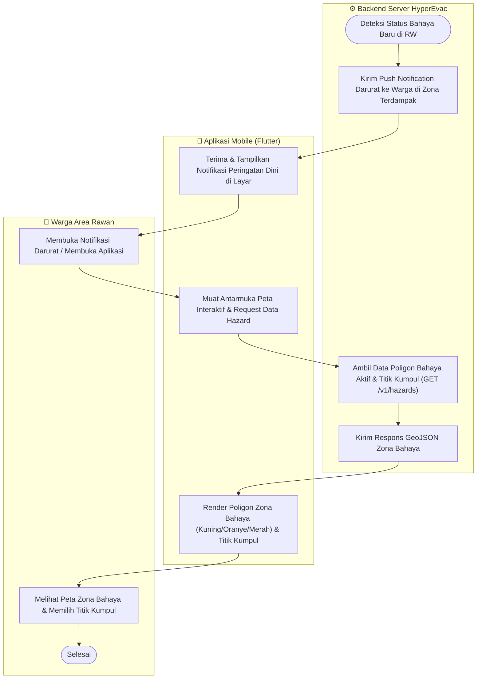
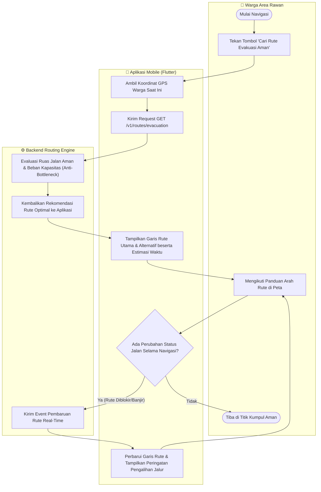
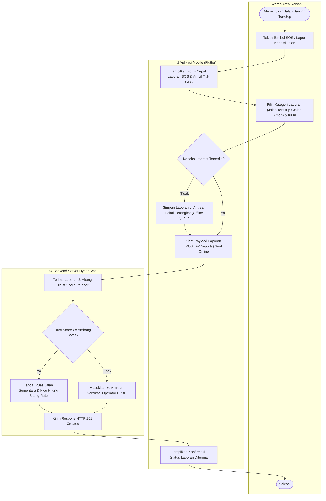
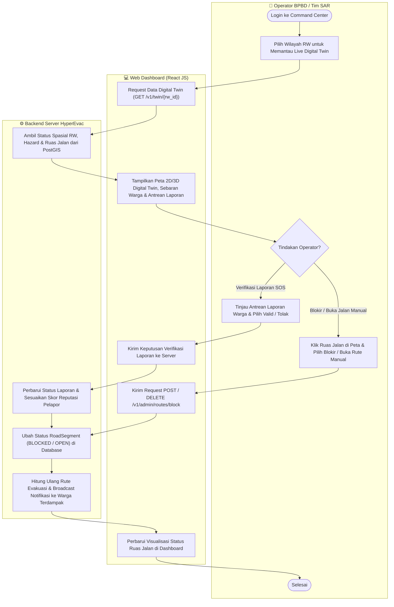
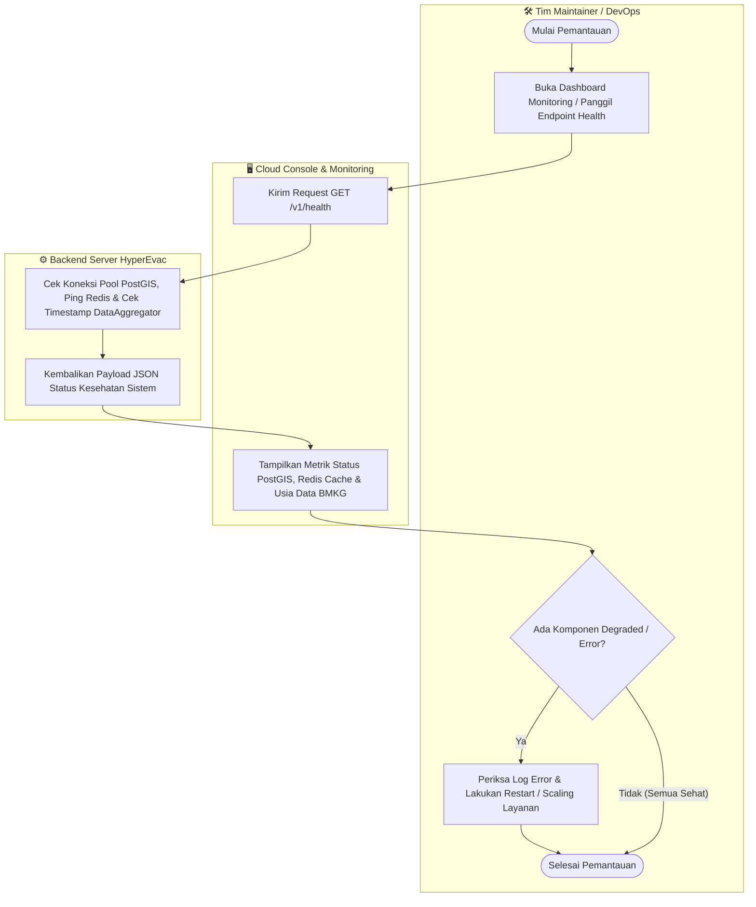

# 🔀 Activity Diagram (Berbasis Swimlane Aktor & Sistem)
**HyperEvac System** · Rekayasa Perangkat Lunak · Universitas Samudra

> [!NOTE]
> Sesuai arahan revisi pembimbing, dokumen **Activity Diagram** ini telah dipisahkan dari **Flowchart Algoritma Sistem** (`FLOWCHART.md`) dan dipecah menjadi diagram terpisah untuk setiap *Use Case* utama dengan menggunakan partisi **Swimlane** (*Aktor*, *Aplikasi Client*, dan *Backend Server*).

---

## 1. Activity Diagram: Penerimaan Peringatan Dini & Lihat Peta Bahaya (`UC1` & `UC2`)

Menggambarkan interaksi aktivitas antara **Warga Area Rawan**, **Aplikasi Mobile**, dan **Backend Server** saat terjadi peringatan dini bencana hingga warga melihat peta zona bahaya aktif.

---

## 2. Activity Diagram: Navigasi Rute Evakuasi & Anti-Bottleneck (`UC3`)

Menggambarkan alur aktivitas terpisah khusus untuk permintaan navigasi rute evakuasi aman beserta pengalihan rute otomatis apabila jalur di depan tertutup atau padat.

---

## 3. Activity Diagram: Pelaporan Kondisi Jalan / Tombol SOS oleh Warga (`UC4`)

Menggambarkan alur aktivitas warga saat melaporkan kondisi jalan tertutup atau aman di lapangan, termasuk penanganan kondisi *offline*.

---

## 4. Activity Diagram: Verifikasi Laporan & Pemblokiran Rute Manual oleh BPBD (`UC5` & `UC6`)

Menggambarkan alur aktivitas **Operator BPBD** pada **Web Dashboard Command Center** saat memantau *Live Digital Twin*, memverifikasi laporan warga, serta memblokir/membuka ruas jalan secara manual.

---

## 5. Activity Diagram: Pemantauan Kesehatan Layanan & Log oleh Tim Maintainer (`UC7`)

Menggambarkan alur aktivitas **Tim Maintainer** dalam memantau ketersediaan layanan (*high availability*), status *cache* API BMKG/USGS, dan performa database.

