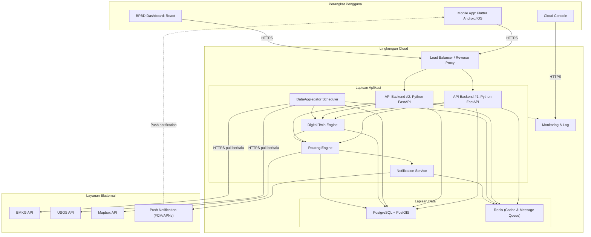

# ☁️ Deployment Diagram

**HyperEvac System** · Rekayasa Perangkat Lunak · Universitas Samudra

> [!NOTE]
> Ini adalah rancangan deployment target Sprint 3. Penyedia cloud belum ditetapkan.

## 1. Diagram

## 2. Peran Komponen

| Komponen | Peran | Catatan |
|---|---|---|
| Load Balancer | Membagi trafik ke beberapa instance API dan mengakhiri HTTPS | Mitigasi server overload |
| API Backend (Python FastAPI) | Melayani REST API untuk aplikasi mobile dan dashboard | Target utama Sprint 3; stateless dan dapat di-scale horizontal |
| DataAggregator | Menarik BMKG/USGS, memvalidasi dan menormalisasi data | Retry serta fallback Redis Cache |
| Digital Twin Engine | Menghitung snapshot kondisi wilayah dan estimasi genangan | Implementasi dan pengujian Sprint 3; software-based tanpa sensor fisik/IoT |
| Routing Engine | Menghitung rute utama/alternatif dan menghindari ruas berbahaya | Menggunakan PostGIS, kapasitas ruas, dan Mapbox |
| Notification Service | Mengirim push notification darurat | Menggunakan antrean Redis dan FCM/APNs |
| PostgreSQL + PostGIS | Penyimpanan data transaksional dan geospasial | Lihat [Class Diagram & Model Data](../sprint-2/CLASS-DAN-DATABASE.md); SQL DDL terpisah direncanakan untuk Sprint 3 |
| Redis | Cache data eksternal dan antrean pesan/notifikasi | Teknologi cache/queue yang ditetapkan untuk target Sprint 3 |
| Monitoring & Log | Memantau uptime, trafik, error, dan status dependensi | Digunakan Tim Maintainer / DevOps |

## 3. Lingkungan

| Lingkungan | Tujuan | Konfigurasi | Estimasi Biaya |
|---|---|---|---|
| **Lokal (dev)** | Pengembangan | Docker Compose: PostgreSQL + PostGIS, Redis; prototipe aggregator Python tersedia | Rp 0 |
| **Testing** | Verifikasi Sprint 3 | Cloud free tier atau lokal, API FastAPI, PostgreSQL/PostGIS, Redis | Rp 0 |
| **Produksi (skala kecil)** | Beta wilayah terbatas | Minimal 2 instance FastAPI, load balancer, PostgreSQL/PostGIS, Redis | ± Rp 100.000/bulan (estimasi proposal) |

## 4. Pemetaan Sprint

- **Sprint 1:** Analisis/desain awal dan prototipe aggregator BMKG.
- **Sprint 2:** Pemodelan lanjutan, kebutuhan data spasial, API, dan alur sistem.
- **Sprint 3:** Implementasi FastAPI, SQL PostGIS, Redis, Routing/Digital Twin Engine, aplikasi Flutter, dashboard React, notifikasi, observability, dan load testing.
