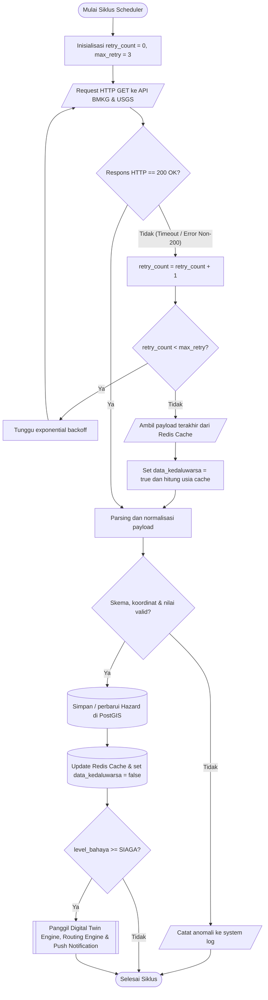
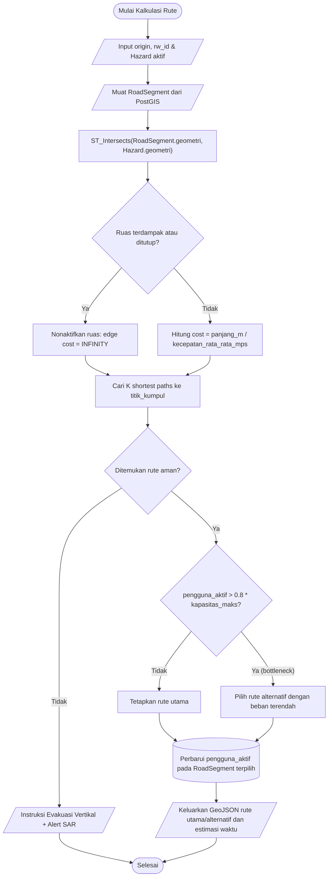
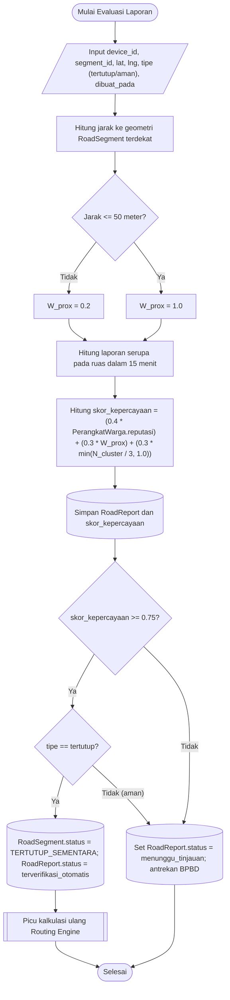

# 🔄 Flowchart Sistem & Algoritma Inti
**HyperEvac System** · Rekayasa Perangkat Lunak · Universitas Samudra

> [!NOTE]
> Flowchart ini mendokumentasikan rancangan algoritma target Sprint 3. Prototipe Sprint 1 saat ini hanya mengimplementasikan aggregator BMKG dengan cache lokal.

## 1. Akuisisi, Validasi & Fallback Cache API (`DataAggregator`)

## 2. Perhitungan Rute Dinamis & Anti-Bottleneck (`RoutingEngine`)

## 3. Evaluasi Trust Score Laporan Warga (`RoadReport`)

Laporan berkepercayaan tinggi hanya dapat menutup ruas secara otomatis jika tipenya `tertutup`. Laporan `aman` tidak membuka ruas tanpa verifikasi BPBD.

