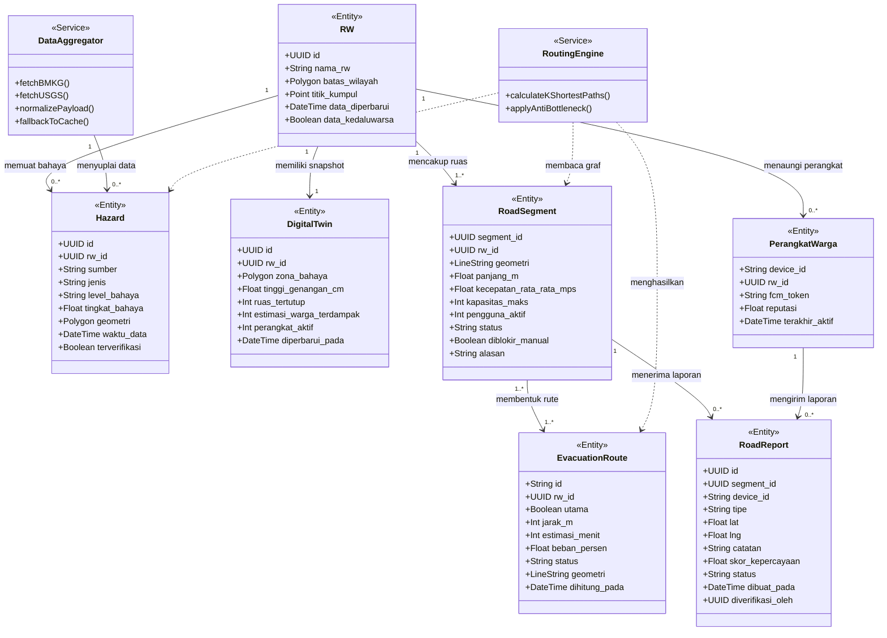

-7b5cff?style=for-the-badge&labelColor=0b1020)

# 🗂️ Class Diagram & Model Data Spasial PostGIS

**HyperEvac System** · Rekayasa Perangkat Lunak · Universitas Samudra

## 1. Struktur Statis dan Hubungan Antar-Entitas

Model domain untuk data spasial PostGIS dengan koordinat WGS 84 / SRID 4326. `<<Entity>>` mewakili tabel data; `<<Service>>` mewakili logika layanan.

`DigitalTwin` 100% berbasis perangkat lunak (*software-based*, tanpa sensor fisik/IoT). Nilai `tinggi_genangan_cm` adalah estimasi berdasarkan data curah hujan BMKG, laporan warga, atau input manual Operator BPBD, bukan pembacaan sensor.

Implementasi DDL PostgreSQL/PostGIS dengan `SRID 4326` direncanakan pada file terpisah `docs/Setup-Code/schema.sql` di Sprint 3. File Markdown diagram ini bukan file SQL dan tidak boleh di-mount sebagai skrip inisialisasi database.
