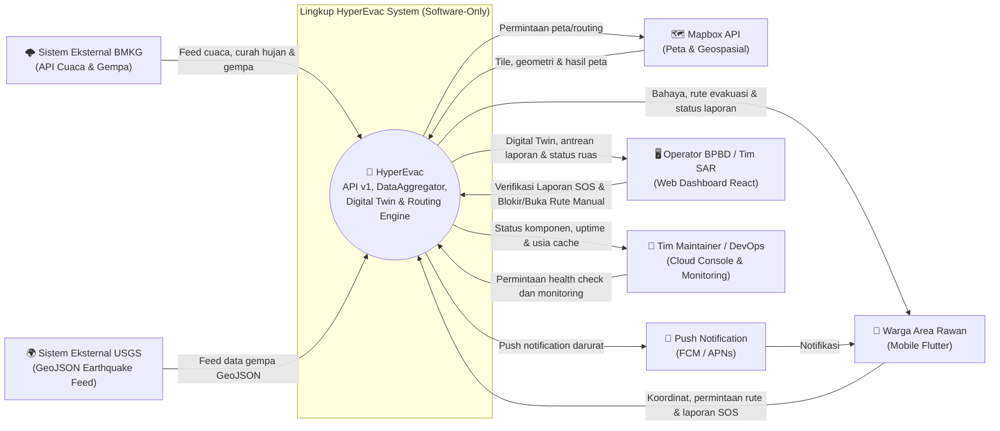

-7b5cff?style=for-the-badge&labelColor=0b1020)

# 🌐 Context Diagram

**HyperEvac System** · Rekayasa Perangkat Lunak · Universitas Samudra

## 1. Lingkup dan Lingkungan Sistem

Diagram konteks mendefinisikan batas HyperEvac serta interaksi data dengan aktor dan sistem eksternal.

## 2. Batas Sistem

- `DataAggregator` adalah komponen internal background scheduler, bukan aktor eksternal.
- Digital Twin sepenuhnya software-based dan tidak bergantung pada sensor fisik/IoT.
- Sprint 1 dan Sprint 2 berisi rancangan dan prototipe terbatas; implementasi layanan target dilakukan pada Sprint 3.
