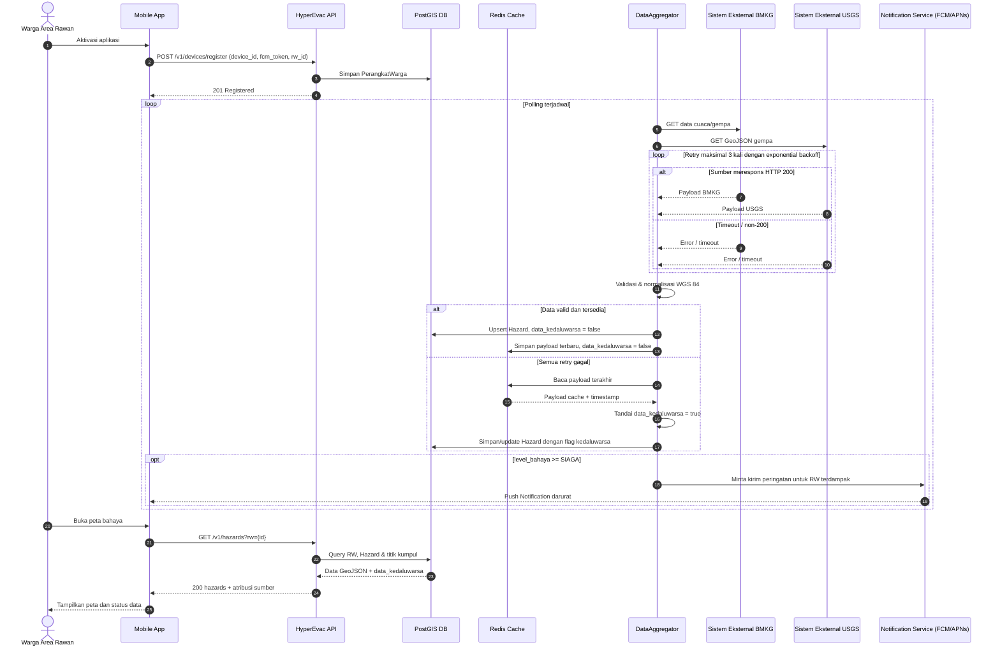
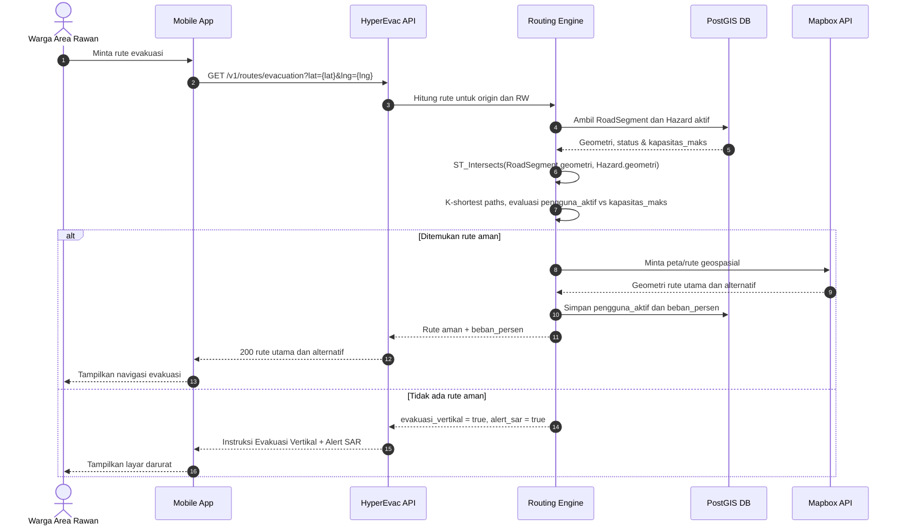
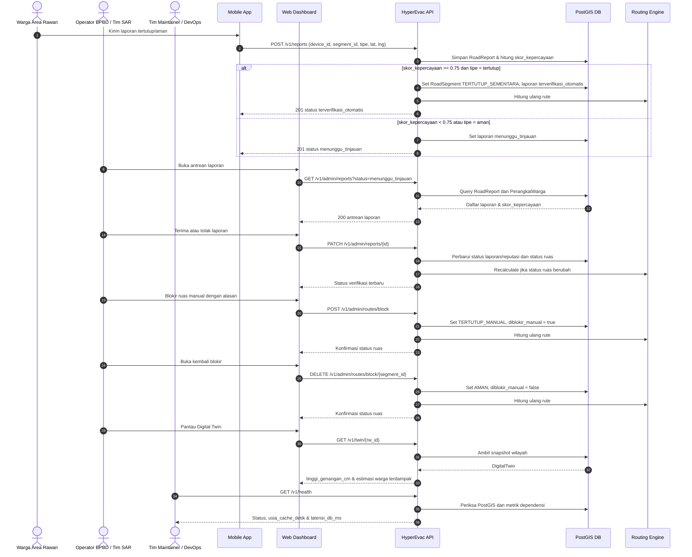

-7b5cff?style=for-the-badge&labelColor=0b1020)

# 🔄 Sequence Diagram

**HyperEvac System** · Rekayasa Perangkat Lunak · Universitas Samudra

## 1. Agregasi Data, Peringatan Dini & Peta Bahaya (`UC1`, `UC2`, `UC8`)

## 2. Permintaan Rute Evakuasi Dinamis & Anti-Bottleneck (`UC3`)

## 3. Laporan SOS, Verifikasi BPBD & Blokir Manual (`UC4`, `UC5`, `UC6`, `UC7`)

