-7b5cff?style=for-the-badge&labelColor=0b1020)

# ⚡ State Diagram

**HyperEvac System** · Rekayasa Perangkat Lunak · Universitas Samudra

## 1. Perubahan Status Ruas Jalan & Kalkulasi Rute Darurat

State ruas menggunakan enum `AMAN`, `MENUNGGU_TINJAUAN`, `TERTUTUP_SEMENTARA`, `TERTUTUP`, dan `TERTUTUP_MANUAL`. Status laporan (`menunggu_tinjauan`, `terverifikasi_otomatis`, `diterima`, `ditolak`) disimpan terpisah.

```mermaid
stateDiagram-v2
    [*] --> AMAN : Inisialisasi sistem

    AMAN --> MENUNGGU_TINJAUAN : POST /v1/reports [skor_kepercayaan < 0.75]
    AMAN --> MENUNGGU_TINJAUAN : POST /v1/reports [tipe = aman]
    AMAN --> TERTUTUP_SEMENTARA : POST /v1/reports [tipe = tertutup & skor_kepercayaan >= 0.75] / RoadReport = terverifikasi_otomatis; hitung ulang rute

    MENUNGGU_TINJAUAN --> AMAN : PATCH /v1/admin/reports/{id} [ditolak]
    MENUNGGU_TINJAUAN --> TERTUTUP : PATCH /v1/admin/reports/{id} [diterima & tipe = tertutup] / hitung ulang rute
    MENUNGGU_TINJAUAN --> AMAN : PATCH /v1/admin/reports/{id} [diterima & tipe = aman]

    TERTUTUP_SEMENTARA --> TERTUTUP : PATCH /v1/admin/reports/{id} [diterima] / hitung ulang rute
    TERTUTUP_SEMENTARA --> AMAN : PATCH /v1/admin/reports/{id} [ditolak] / hitung ulang rute

    AMAN --> TERTUTUP_MANUAL : POST /v1/admin/routes/block [diblokir_manual = true] / hitung ulang rute
    TERTUTUP_MANUAL --> AMAN : DELETE /v1/admin/routes/block/{segment_id} / hitung ulang rute
    TERTUTUP --> AMAN : Kondisi lapangan pulih dan dikonfirmasi Operator BPBD
```

