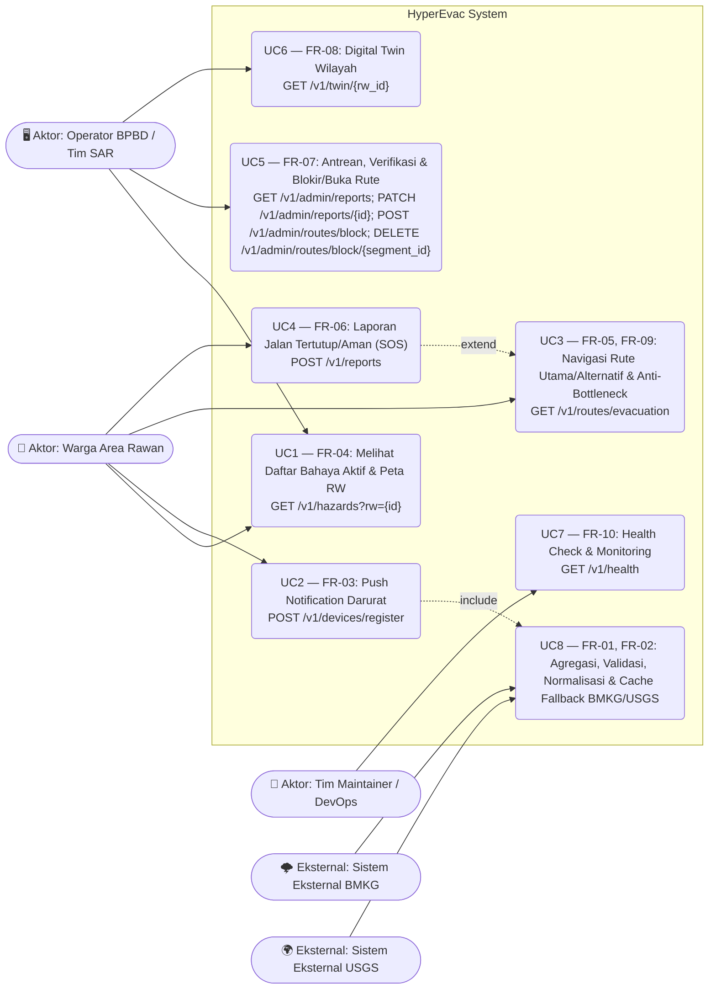

-7b5cff?style=for-the-badge&labelColor=0b1020)

# 👥 Use Case Diagram

**HyperEvac System** · Rekayasa Perangkat Lunak · Universitas Samudra

## 1. Pemetaan Interaksi Aktor dan Sistem

Diagram memetakan FR-01 sampai FR-10 kepada aktor, use case, dan kontrak endpoint yang dirancang.

## 2. Pemetaan FR, Use Case, User Story & Endpoint

| FR | Use Case | User Story | Endpoint / Mekanisme |
|---|---|---|---|
| FR-01 | UC8 | US-01 | Worker DataAggregator: fetch BMKG/USGS, retry, Redis fallback |
| FR-02 | UC8 | US-02 | Validasi dan normalisasi geospasial WGS 84 |
| FR-03 | UC2 | US-03 | `POST /v1/devices/register` dan Notification Service |
| FR-04 | UC1 | US-04 | `GET /v1/hazards?rw={id}` |
| FR-05 | UC3 | US-05 | `GET /v1/routes/evacuation?lat={lat}&lng={lng}` |
| FR-06 | UC4 | US-07 | `POST /v1/reports` |
| FR-07 | UC5 | US-08 | `GET /v1/admin/reports`; `PATCH /v1/admin/reports/{id}`; `POST /v1/admin/routes/block`; `DELETE /v1/admin/routes/block/{segment_id}` |
| FR-08 | UC6 | US-09 | `GET /v1/twin/{rw_id}` |
| FR-09 | UC3 | US-06 | Distribusi rute alternatif saat beban ruas > 80% |
| FR-10 | UC7 | US-10 | `GET /v1/health` |
